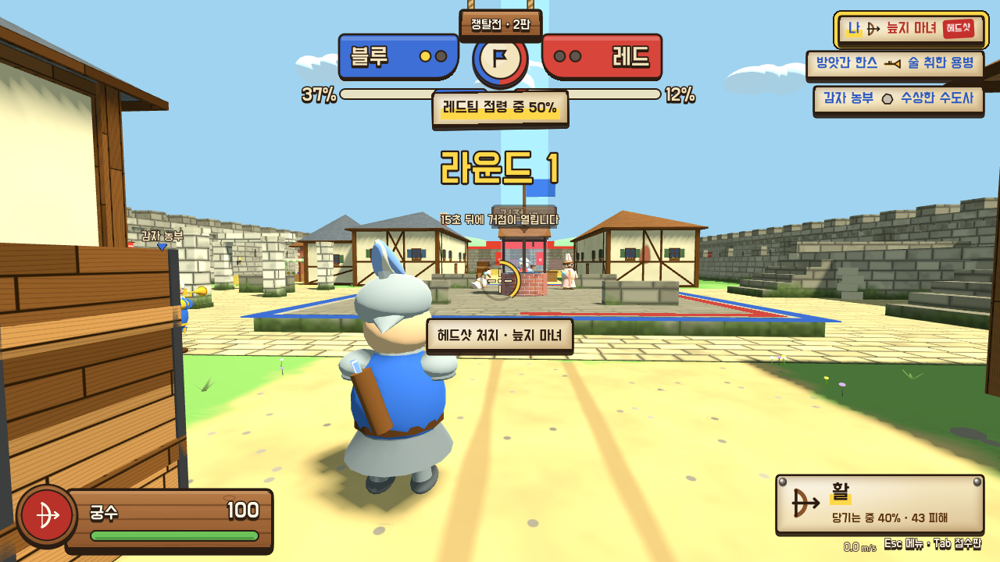

# 중세난장판

> 일단 던져.

중세풍 **병맛 FPS**입니다. 흐물흐물한 기사·야만인·성직자들이 돌멩이와 화살, 성수, 트럼펫을 들고 싸웁니다.
급하게 돌면 넘어지고, 활을 너무 오래 당기면 손이 미끄러지고, 가끔 하늘에서 AK-47이 떨어집니다.

Three.js로 만든 HTML 프로토타입을 **Godot 4.7**로 옮긴 프로젝트입니다. 웹 브라우저와 Windows에서 돌아갑니다.



---

## 무엇을 할 수 있나

### 병과 5개

| 병과 | 무기 | 체력 | 특징 |
|---|---|---|---|
| 야만인 | 돌멩이 | 90 | 가장 빠름. 누르고 있으면 0.4초마다 연사 |
| 궁수 | 활 | 100 | 당길수록 세고 빠름 (피해 15~50). 끝까지 당긴 채 3초면 손이 미끄러짐 |
| 석궁병 | 석궁 | 110 | 피해 75, 헤드샷이면 한 방. **마우스 휠을 아래로 25칸** 굴려야 다시 장전 |
| 성직자 | 성수 | 100 | 깨진 자리에 웅덩이 — 적은 피해 + 65% 느려짐, 나는 회복 |
| 음유시인 | 트럼펫 | 95 | 앞쪽 원뿔 안의 적을 **춤추게** 만듦 (춤추는 동안 공격 못 함). 우클릭 팡파레 |

### 모드
- **AI대전 개인전** — 봇 7명과 4분 동안, 먼저 20킬이면 끝
- **AI대전 쟁탈전 (5:5)** — 가운데 우물 광장 거점을 점령하는 3판 2선승
- **친구대전** — 같은 와이파이에서 방 코드 4자리로 (PC 버전만). 개인전·쟁탈전 둘 다, 빈자리는 봇이 채움
- 봇 난이도: 쉬움 / 보통 / 어려움

### 특수 아이템
- **대물 저격총** — 맞으면 즉사, 5발
- **AK-47** — 25발 연사
- **기사의 말 + 마상창** — 7초 동안 타고 달림, 창에 걸리면 멀리 날아감
- **닭** — 잡아서 던지면 맞은 사람이 무조건 넘어짐
- **황금 붕어빵** — 먹으면 8초 무적 + 몸박치기 (BGM이 메탈로 바뀜)

---

## 조작

| 동작 | 키 |
|---|---|
| 이동 | W A S D |
| 달리기 | 왼쪽 Shift (앞으로 갈 때만) |
| 슬라이드 | 달리다가 Ctrl 또는 C |
| 점프 | Space |
| 공격 | 좌클릭 |
| 조준 (음유시인은 팡파레) | 우클릭 |
| 석궁 장전 | 마우스 휠 아래로 |
| 활 당기기 취소 | R |
| 특수 무기 ↔ 원래 무기 | Q |
| 1인칭 / 3인칭 | V |
| 점수판 | Tab |
| 일시정지 | Esc |
| 명중 판정 디버그 표시 (개발용) | F9 |

---

## 실행하기

### 에디터에서
1. [Godot 4.7](https://godotengine.org/) (Standard 버전, 4.7.2에서 확인)을 받습니다. C#(.NET) 버전은 필요 없습니다.
2. Godot 프로젝트 관리자에서 `project.godot`을 엽니다.
3. F5로 실행하면 메인 메뉴가 뜨고, 뒤에서 봇들이 싸우는 걸 구경할 수 있습니다.

### 웹으로 내보내기
웹 내보내기 템플릿(`web_nothreads_release`)이 깔려 있어야 합니다.

```bash
godot --headless --path . --export-release "Web" export/web/index.html
cd export/web && python -m http.server 8060   # 브라우저로 http://localhost:8060
```

스레드 없는 빌드라 특별한 서버 설정(COOP/COEP) 없이 GitHub Pages·itch.io에 그대로 올릴 수 있습니다.
웹에서는 친구대전을 쓸 수 없습니다.

### Windows exe로 내보내기 (친구대전용)

```bash
godot --headless --path . --export-release "Windows" "export/windows/중세난장판.exe"
```

exe 하나에 게임 데이터가 다 들어 있어서 이 파일만 친구에게 주면 됩니다.
- 처음 실행할 때 Windows SmartScreen이 막으면 "추가 정보 → 실행"을 누릅니다 (코드 서명을 안 해서).
- 방을 처음 만들 때 방화벽이 물어보면 **개인 네트워크 허용**을 눌러야 친구가 들어올 수 있습니다 (포트 24680·24681).

---

## 자동 테스트

이동·전투·봇·UI 규칙을 헤드리스로 확인하는 테스트가 `tests/`에 있습니다. 모두 `ALL PASS`가 나와야 합니다.

```bash
# 스크립트 오류 확인
godot --headless --path . --quit-after 120

# 예: 석궁 테스트
godot --headless --fixed-fps 60 --path . -s tests/test_crossbow.gd
```

전체 목록과 성능 측정 도구(`tests/perf_*.gd`, 화면 필요)는 [CLAUDE.md](CLAUDE.md)의 "테스트 실행"에 있습니다.

---

## 폴더 구조

```
project.godot          프로젝트 설정 (렌더러 Compatibility, 물리 Jolt 60Hz)
scenes/                main.tscn (게임 전체), player.tscn (캐릭터)
scripts/game_data.gd   ★ 모든 수치·병과·무기·색. 밸런스는 이 파일만 고치면 됨
scripts/               전투(combat), 캐릭터(player·derp_model), 봇(bot_ai), 맵(world_builder·maps/),
                       아이템(items), 친구대전(net), HUD·메뉴(hud·menu·ui_kit·ui/), 소리(sfx·music)
shaders/               맵 무늬 (벽돌·판자·기와·잔디 …)
audio/                 배경음악·효과음
fonts/                 도현·개구·Noto (모두 OFL)
tests/                 자동 테스트 · 사진 찍는 스크립트 · 성능 측정
reference/             원본 HTML 프로토타입, UI 시안
```

개발 규칙·게임 규칙 명세·설계 메모는 [CLAUDE.md](CLAUDE.md)에 자세히 적혀 있습니다.

---

## 만든 방법

- 엔진: Godot 4.7, **GDScript만** (웹으로 내보내려고 C#은 안 씀)
- 그래픽: 외부 3D 모델 없이 **기본 도형 조합**으로 만든 흐물흐물 캐릭터와 마을, 무늬는 셰이더로 그림
- UI: "마을 게시판" 스타일 — 나무판·양피지·금칠, 쇠못과 밧줄

## 라이선스 · 출처

- 글꼴: [도현](https://fonts.google.com/specimen/Do+Hyeon), [개구](https://fonts.google.com/specimen/Gaegu), Noto Sans — 모두 SIL Open Font License (`fonts/OFL*.txt`)
- 효과음: 직접 만든 소리 (`audio/sfx/`)
